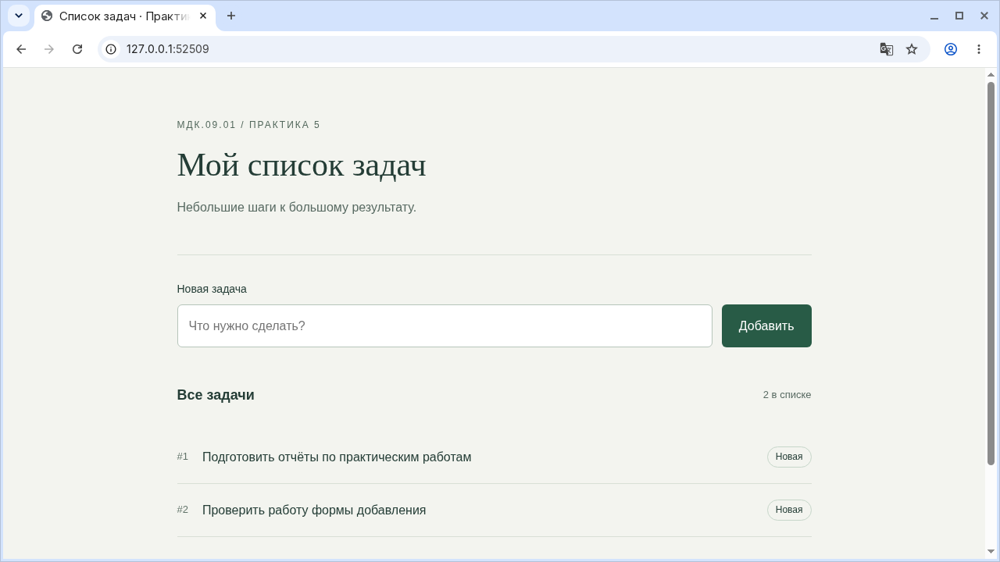

**Миронова Анна Андреевна**

**Группа: 4-ИСП9-46**

| Работа | Отчёт | Код |
|---|---|---|
| МДК.09.01 №1: Инициализация базы данных SQLite | [PDF](%D0%9C%D0%94%D0%9A09_%D0%9F%D0%A001_SQLite_%D0%9C%D0%B8%D1%80%D0%BE%D0%BD%D0%BE%D0%B2%D0%B0_%D0%90%D0%BD%D0%BD%D0%B0_%D0%90%D0%BD%D0%B4%D1%80%D0%B5%D0%B5%D0%B2%D0%BD%D0%B0_4-%D0%98%D0%A1%D0%9F9-46.pdf) | [Код](web/practice_01) |
| МДК.09.01 №2: Базовые CRUD-операции через консоль | [PDF](%D0%9C%D0%94%D0%9A09_%D0%9F%D0%A002_CRUD_%D0%9C%D0%B8%D1%80%D0%BE%D0%BD%D0%BE%D0%B2%D0%B0_%D0%90%D0%BD%D0%BD%D0%B0_%D0%90%D0%BD%D0%B4%D1%80%D0%B5%D0%B5%D0%B2%D0%BD%D0%B0_4-%D0%98%D0%A1%D0%9F9-46.pdf) | [Код](web/practice_02) |
| МДК.09.01 №3: Подключение Flask и первый маршрут | [PDF](%D0%9C%D0%94%D0%9A09_%D0%9F%D0%A003_Flask_%D0%9C%D0%B8%D1%80%D0%BE%D0%BD%D0%BE%D0%B2%D0%B0_%D0%90%D0%BD%D0%BD%D0%B0_%D0%90%D0%BD%D0%B4%D1%80%D0%B5%D0%B5%D0%B2%D0%BD%D0%B0_4-%D0%98%D0%A1%D0%9F9-46.pdf) | [Код](web/practice_03) |
| МДК.09.01 №4: Flask и SQLite: чтение данных | [PDF](%D0%9C%D0%94%D0%9A09_%D0%9F%D0%A004_%D0%A7%D1%82%D0%B5%D0%BD%D0%B8%D0%B5_%D0%9C%D0%B8%D1%80%D0%BE%D0%BD%D0%BE%D0%B2%D0%B0_%D0%90%D0%BD%D0%BD%D0%B0_%D0%90%D0%BD%D0%B4%D1%80%D0%B5%D0%B5%D0%B2%D0%BD%D0%B0_4-%D0%98%D0%A1%D0%9F9-46.pdf) | [Код](web/practice_04) |
| МДК.09.01 №5: Flask и SQLite: добавление данных | [PDF](%D0%9C%D0%94%D0%9A09_%D0%9F%D0%A005_%D0%A4%D0%BE%D1%80%D0%BC%D0%B0_%D0%9C%D0%B8%D1%80%D0%BE%D0%BD%D0%BE%D0%B2%D0%B0_%D0%90%D0%BD%D0%BD%D0%B0_%D0%90%D0%BD%D0%B4%D1%80%D0%B5%D0%B5%D0%B2%D0%BD%D0%B0_4-%D0%98%D0%A1%D0%9F9-46.pdf) | [Код](web/practice_05) |
| МДК.05.03: Тестирование типовых ИС в Linux | [PDF](%D0%9C%D0%94%D0%9A05_01_linux_system_%D0%9C%D0%B8%D1%80%D0%BE%D0%BD%D0%BE%D0%B2%D0%B0_%D0%90%D0%BD%D0%BD%D0%B0_%D0%90%D0%BD%D0%B4%D1%80%D0%B5%D0%B5%D0%B2%D0%BD%D0%B0_4-%D0%98%D0%A1%D0%9F9-46.pdf) | [Код](testing/linux_system) |
| МДК.05.03: Bash: базовые проверки ИС и обработка сбоев | [PDF](%D0%9C%D0%94%D0%9A05_02_linux_kernel_%D0%9C%D0%B8%D1%80%D0%BE%D0%BD%D0%BE%D0%B2%D0%B0_%D0%90%D0%BD%D0%BD%D0%B0_%D0%90%D0%BD%D0%B4%D1%80%D0%B5%D0%B5%D0%B2%D0%BD%D0%B0_4-%D0%98%D0%A1%D0%9F9-46.pdf) | [Код](testing/linux_kernel) |
| МДК.05.03: Bash, часть 1: отдельные тесты и общий запуск | [PDF](%D0%9C%D0%94%D0%9A05_03_bash_basics_%D0%9C%D0%B8%D1%80%D0%BE%D0%BD%D0%BE%D0%B2%D0%B0_%D0%90%D0%BD%D0%BD%D0%B0_%D0%90%D0%BD%D0%B4%D1%80%D0%B5%D0%B5%D0%B2%D0%BD%D0%B0_4-%D0%98%D0%A1%D0%9F9-46.pdf) | [Код](testing/bash_basics) |
| МДК.05.03: Bash, часть 2: логи, архивы, INI, CSV и порты | [PDF](%D0%9C%D0%94%D0%9A05_04_bash_extended_%D0%9C%D0%B8%D1%80%D0%BE%D0%BD%D0%BE%D0%B2%D0%B0_%D0%90%D0%BD%D0%BD%D0%B0_%D0%90%D0%BD%D0%B4%D1%80%D0%B5%D0%B5%D0%B2%D0%BD%D0%B0_4-%D0%98%D0%A1%D0%9F9-46.pdf) | [Код](testing/bash_extended) |
| МДК.05.03: JSON, часть 3: чтение, запись и отчёты | [PDF](%D0%9C%D0%94%D0%9A05_05_json_operations_%D0%9C%D0%B8%D1%80%D0%BE%D0%BD%D0%BE%D0%B2%D0%B0_%D0%90%D0%BD%D0%BD%D0%B0_%D0%90%D0%BD%D0%B4%D1%80%D0%B5%D0%B5%D0%B2%D0%BD%D0%B0_4-%D0%98%D0%A1%D0%9F9-46.pdf) | [Код](testing/json_operations) |
| МДК.05.03: JSON, часть 4: структура, типы и ограничения | [PDF](%D0%9C%D0%94%D0%9A05_06_json_validation_%D0%9C%D0%B8%D1%80%D0%BE%D0%BD%D0%BE%D0%B2%D0%B0_%D0%90%D0%BD%D0%BD%D0%B0_%D0%90%D0%BD%D0%B4%D1%80%D0%B5%D0%B5%D0%B2%D0%BD%D0%B0_4-%D0%98%D0%A1%D0%9F9-46.pdf) | [Код](testing/json_validation) |
| МДК.05.03: Postman: установка, коллекция и первые API-тесты | [PDF](%D0%9C%D0%94%D0%9A05_07_postman_%D0%9C%D0%B8%D1%80%D0%BE%D0%BD%D0%BE%D0%B2%D0%B0_%D0%90%D0%BD%D0%BD%D0%B0_%D0%90%D0%BD%D0%B4%D1%80%D0%B5%D0%B5%D0%B2%D0%BD%D0%B0_4-%D0%98%D0%A1%D0%9F9-46.pdf) | [Код](testing/postman) |
| МДК.05.03: Методологии тестирования и практический цикл STLC | [PDF](%D0%9C%D0%94%D0%9A05_08_stlc_%D0%9C%D0%B8%D1%80%D0%BE%D0%BD%D0%BE%D0%B2%D0%B0_%D0%90%D0%BD%D0%BD%D0%B0_%D0%90%D0%BD%D0%B4%D1%80%D0%B5%D0%B5%D0%B2%D0%BD%D0%B0_4-%D0%98%D0%A1%D0%9F9-46.pdf) | [Код](testing/stlc) |

Инструкция по запуску: [docs/ЗАПУСК.md](docs/ЗАПУСК.md)

